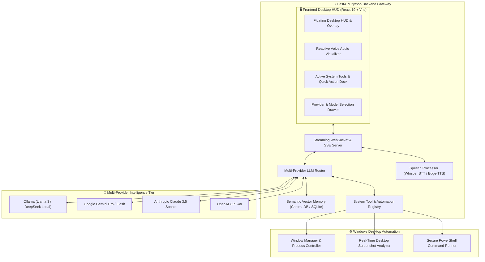
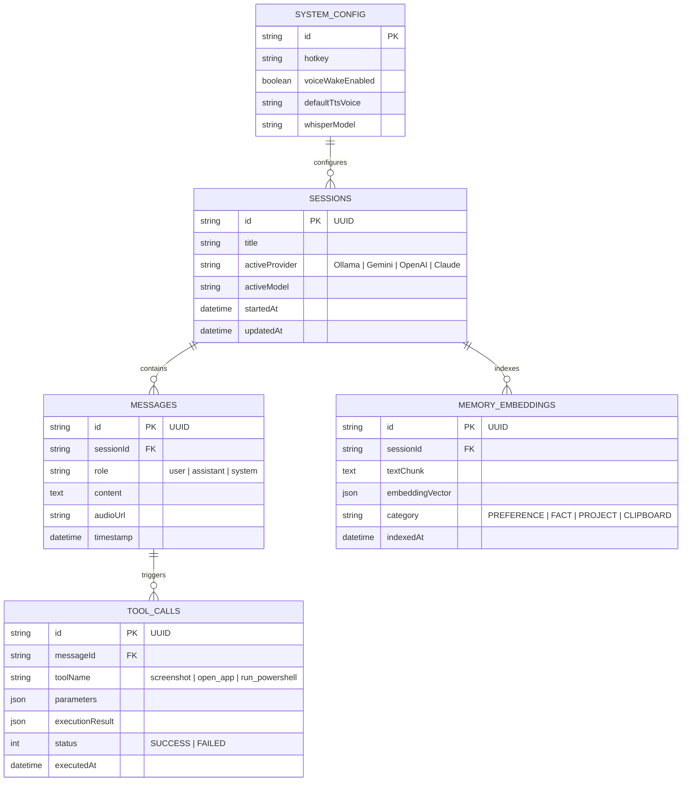
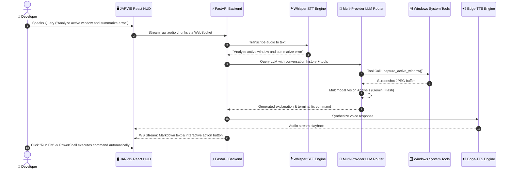

# 🤖 JARVIS — Modern Windows Desktop AI Assistant & Automation Cockpit

<div align="center">


**A modular, provider-agnostic Windows desktop AI assistant built with a Python FastAPI backend and a high-performance React 19 HUD frontend. Capable of local offline LLM reasoning (Ollama), cloud model routing (Gemini, Claude, GPT-4o), voice interaction, semantic memory recall, screen analysis, and desktop automation.**

[System Architecture](#-system-architecture) • [State Machine & ERD](#-state-machine--context-model) • [Interaction Flow](#-voice--tool-execution-flow) • [Quick Start](#-quick-start)

</div>

---

## ⚡ Overview

**JARVIS** transforms your Windows desktop into an autonomous, proactive AI workspace. Rather than locking you into a single proprietary API, JARVIS features an intelligent provider router that seamlessly switches between zero-latency local models (via **Ollama**) and powerful cloud models (**Gemini 2.5 Flash**, **Claude 3.5 Sonnet**, **GPT-4o**). It can see your screen, run system diagnostic tools, control windows, and speak responses with low-latency TTS.

---

## 🏗️ System Architecture



---

## 📊 State Machine & Context Model



---

## 🔄 Voice & Tool Execution Flow



---

## 🚀 Quick Start

### 1. Python Backend Setup
```bash
# Create and activate virtual environment
python -m venv venv
venv\Scripts\activate

# Install Dependencies
pip install -r requirements.txt

# Run Backend
python run.py
```

### 2. Frontend Desktop HUD Setup
```bash
cd app/ui
pnpm install
pnpm run dev
```

Visit `http://localhost:5173` to open the JARVIS HUD.

---

## 📄 License
MIT License © **[Ros Rendo](https://github.com/RosRendo)**
